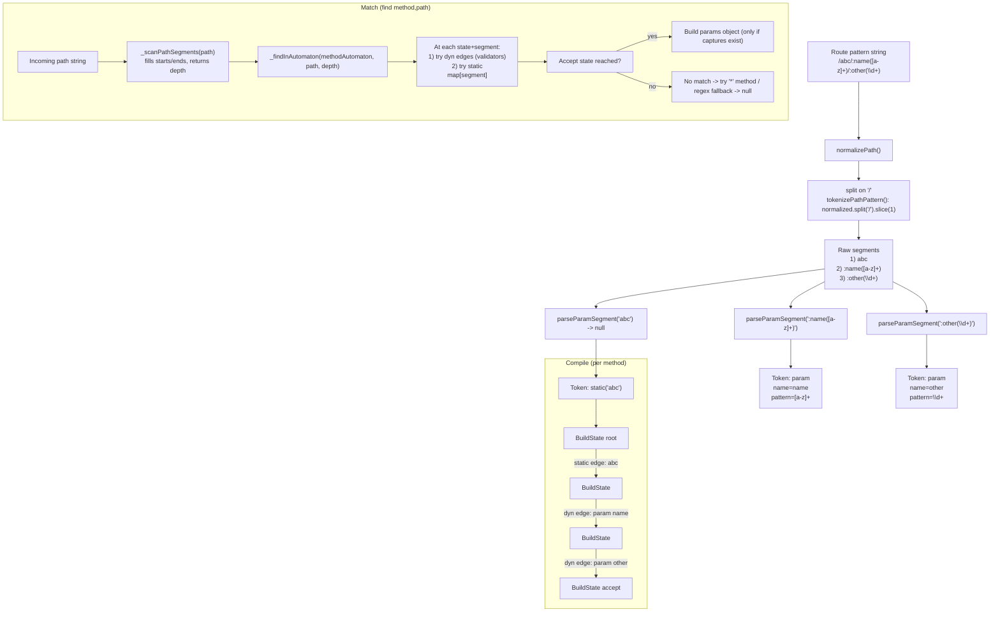
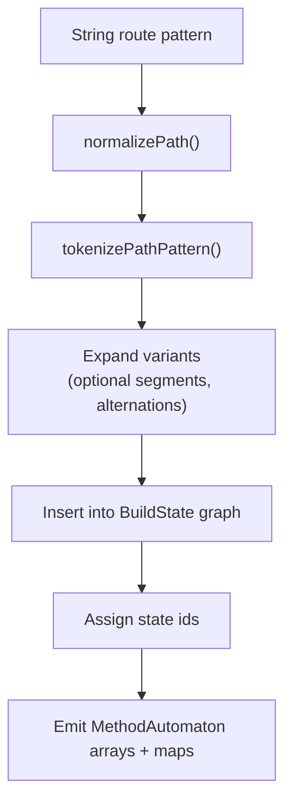
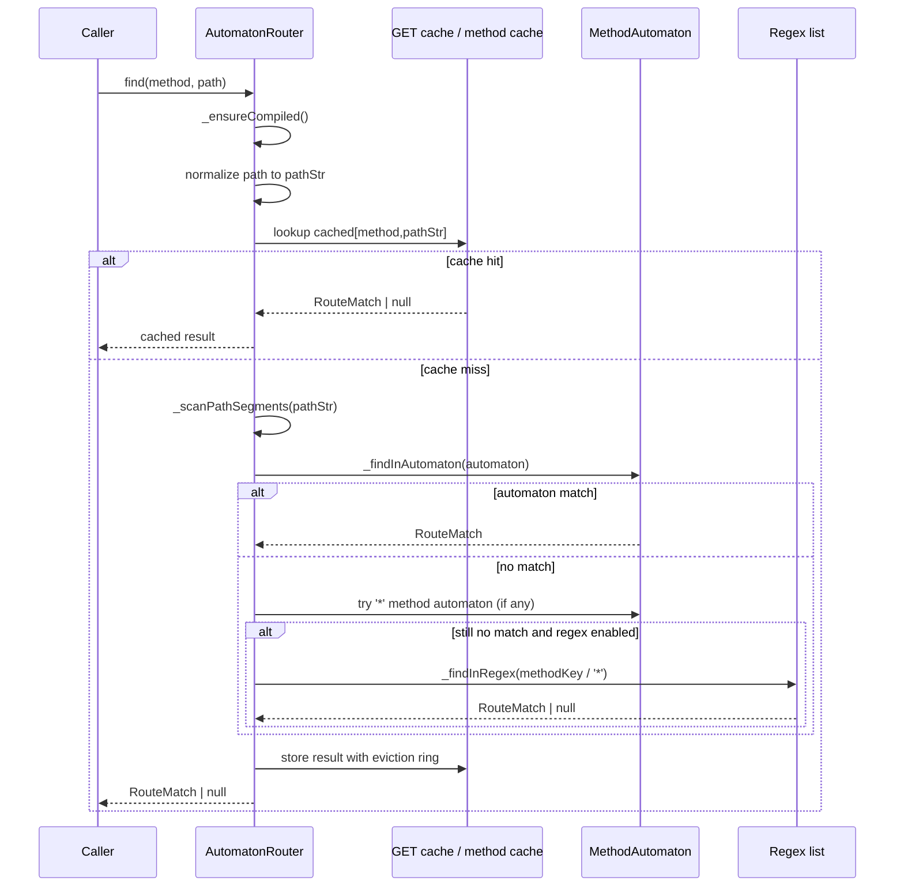
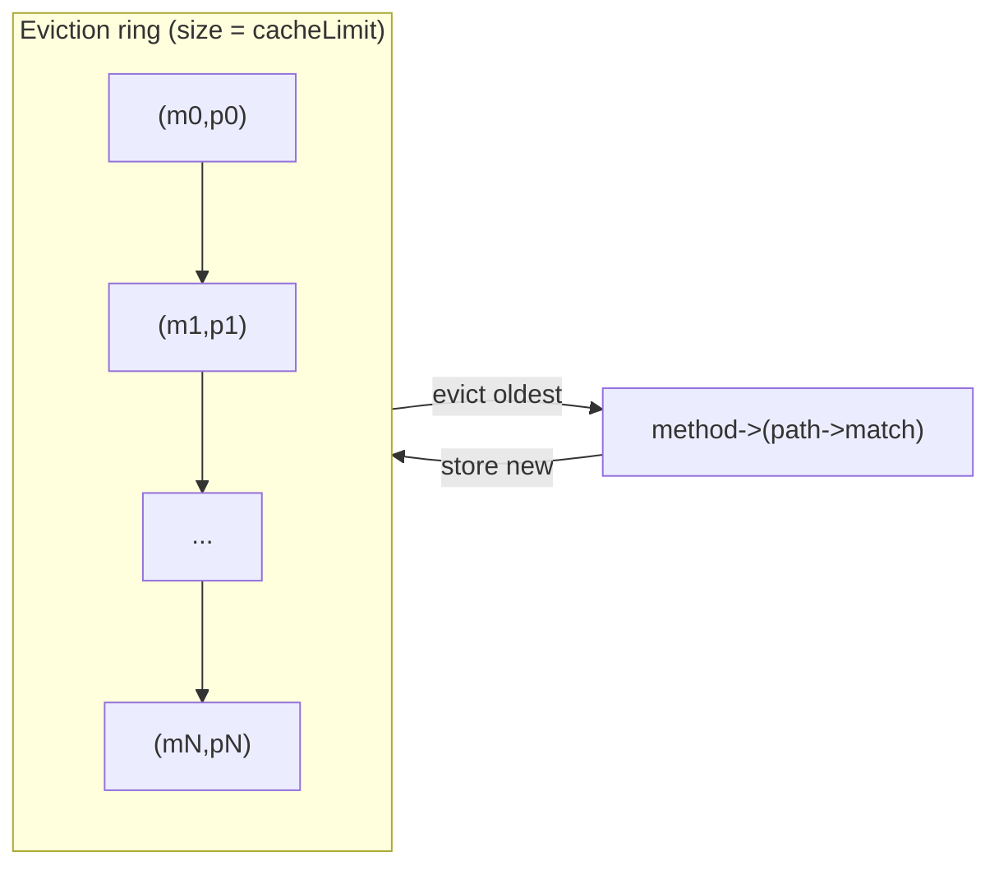

# How It Works (balancing-router-v2 / AutomatonRouter)

This document explains the high-level design of the v2 router implemented in `src/automaton-router.ts`.

The key idea is:

- **Build phase:** Convert route patterns into a **per-method deterministic-ish automaton** (states + edges) plus an optional regex fallback list.
- **Match phase:** Normalize input, **scan path segments once**, then walk the automaton to find the first acceptable route, producing params only when needed.
- **Caching:** A large **GET path cache** plus a bounded ring-buffer eviction shared across methods.

## Public API Surface

- `router.on(method, path, handler, store?)`
  - Adds a route definition; compilation is deferred until first lookup.
  - `path` can be a string pattern or a `RegExp`.
- `router.find(method, path)`
  - Returns `{ handler, params, store? }` or `null`.
  - Internally normalizes `method` and ensures `path` starts with `/`.

## Data Model At A Glance

At runtime, v2 matches using a compact per-method automaton:

- **States** are integer ids starting at `0` (root state).
- **Static edges** (literal segments) are stored in a per-state map: `stateStaticMaps[state][literal] -> nextState`.
- **Dynamic edges** (params and wildcards) are stored in parallel typed arrays:
  - `stateDynOffset[state]` / `stateDynCount[state]` provide a slice into:
    - `dynKind[]` (param or wildcard)
    - `dynNameIds[]` (index into `paramNames[]`)
    - `dynValidatorIds[]` (index into router validator table)
    - `dynNext[]` (next state id)
- **Accept state**: `stateAcceptIndex[state]` points to an `accepts[]` entry containing `{handler, store?}`.

## Build Phase (Compilation)

Compilation happens lazily on the first `find()` call:

1. Route definitions are collected by `on(...)`.
2. `_ensureCompiled()` calls `_compile()` if needed and clears caches.
3. `_compile()`:
   - Splits routes into:
     - **String pattern routes** (compiled into automata)
     - **Regex routes** (kept as ordered lists with a cheap `minDepth` filter)
   - Builds a `MethodAutomaton` for each method.
   - Also caches pointers to the GET and `*` (wildcard method) automata for fast dispatch.

### Pattern Tokenization

String patterns are tokenized into segments:

- Static: `users`
- Param: `:id` (optional validator pattern)
- Wildcard: `:rest*` (captures the rest of the path)

Optional segments and simple alternations are expanded into multiple variants at compile time.

### BuildState Graph

During compilation, each method is first represented as a graph of `BuildState` objects:

- `staticEdges: Map<string, BuildState>`
- `dynEdges: Array<{kind, name, validatorId, next, score, order}>`
- `acceptIndex` if a route ends at this state

Dynamic edges are sorted so that “more specific” matches are tried first (e.g. `:id(#int)` before `:id` before `:rest*`).

## Match Phase (Lookup)

`find(method, path)` performs a small dispatch + fast caching:

1. Ensure compilation is done.
2. Normalize `path` to ensure a leading `/` (fast `charCodeAt(0) === 47`).
3. Fast path for GET:
   - Check `_cacheGET[pathStr]` and return cached value if present.
4. Otherwise resolve:
   - `_findResolved(methodKey, pathStr)`
5. Store in cache (GET has a specialized insert; others share a method map).

### Segment Scanning (Once)

Before walking the automaton, the router scans `pathStr` to identify each segment’s `[start,end)` indices.

This avoids splitting strings into an array of segments and keeps allocations low.

- `_scanPathSegments(pathStr)` populates:
  - `_segmentStarts[]`
  - `_segmentEnds[]`
  - returns `depth` (segment count)

The matcher then uses `path.slice(starts[i], ends[i])` to obtain the current segment string only when needed.

### Automaton Walk (DFS with Manual Stacks)

`_findInAutomaton(automaton, pathStr, depth)` walks the state machine with explicit stacks to avoid recursion:

- `stateStack[]`, `indexStack[]` track backtracking frames
- capture stacks track param values only when dynamic edges are traversed

Key behaviors:

- At a state:
  - If `index === depth`:
    - if accepting state: return handler (build params object only if captures exist)
    - also consider wildcard edges that can match “empty rest”
  - Else:
    - try dynamic edges (params/wildcard) with validators
    - then try static edge for the current segment

Note: edges are pushed in reverse order so that the highest-priority edge is visited first.

### Validators and Wildcards

Param validators are pre-registered at compile time and referenced by small integer ids.

- Common validators are implemented as fast character checks (`int`, `alpha`, `slug`, `locale`, `uuid`).
- Arbitrary patterns compile to `new RegExp('^...$')` and are tested only when that edge is explored.

Wildcard params capture “the rest of the path”. The router avoids building the rest string during traversal; it records an index and later constructs it from the known segment boundaries only if that wildcard capture is part of the winning match.

## Regex Routes (Fallback)

Routes defined as `RegExp` are not compiled into the automaton. They are stored per method as an ordered list with a `minDepth` hint:

- `minDepth` is derived from a literal prefix extraction (best-effort).
- During match, regex routes are only tested when `minDepth <= depth`.

This keeps regex support available without forcing the automaton fast path to depend on regex checks in the common case.

## Caching and Eviction

The router caches full `(method, pathStr)` lookup results:

- GET has a dedicated object cache: `_cacheGET[pathStr]`.
- Other methods have a per-method object cache stored in `_cacheOther`.
- A shared ring buffer stores `(method, pathStr)` keys to evict the oldest entry when the cache is full.

Important properties:

- Cache stores both hits and misses (`null`) to accelerate 404-heavy traffic.
- Cache is cleared on compilation to avoid stale handlers after route changes.

## Practical Notes

- v2 is designed for **fast steady-state lookups** after a one-time compilation.
- Most performance work tends to focus on:
  - `_scanPathSegments` (per-request cost)
  - `_findInAutomaton` (backtracking, validator checks, and segment slicing)
  - caching behavior under mixed hit/404 workloads
